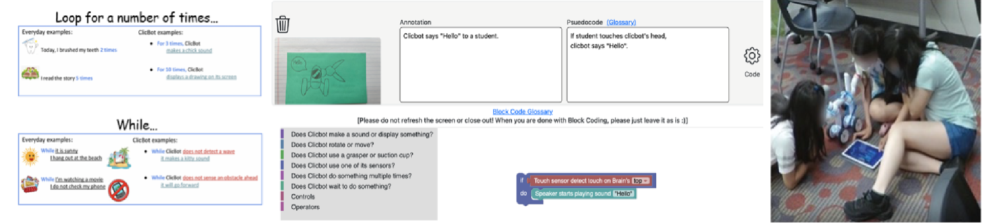
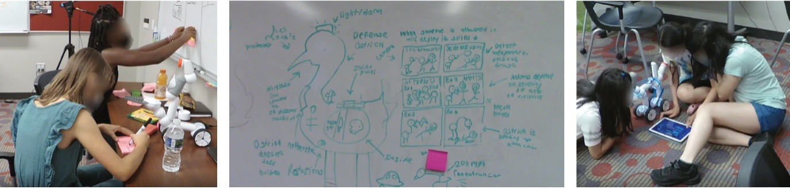

The MyTurn project focused on developing a social robotics curriculum for middle school students. It brings together social robotics, personally meaningful programming projects, peer collaboration, and mentorship to support middle school students’ interest and participation in computing.

The curriculum was first implemented in a camp setting with later iterations deployed in after-school and classroom settings. We also designed and implemented workshops in partner schools as part of our community outreach efforts.

## My Contributions

As lead researcher for MyTurn for 6 years, I oversaw every aspect of this project from grant-writing, study design, research assistant training, data analysis and writing, and disemmination of results to peer-reviewed conferences and journals.

I designed a web-based pre-coding tool that supports students as they move from brainstorming and storyboarding to annotation, pseudocode, block-code planning, and implementation. I examined how students interacted with the tool alongside peers and mentors during project-based social robotics activities. This work investigated how technological and social scaffolds can support engagement, learning, and interest in computing.

## Curriculum and Resources

MyTurn is a social robotics curriculum grounded in the DICE framework (Michaelis & Weintrop, 2022). It integrates multiple interest support for computing knowledge, value, and belonging to promote students’ interest in computer science. These interest supports can also address persistent stereotypes in computing.

[**Explore the MyTurn curriculum and teaching materials**](https://drive.google.com/drive/folders/1gfS5lvPu8fDS5BsMyKSnctlIWG9L8K4R?usp=sharing)

[** View Computer Science Education Journal Article **](https://doi.org/10.1080/08993408.2026.2747289)

[**View the ISLS poster**](https://drive.google.com/file/d/1vnkqHqjkmUEzFSWCdtIotenQL8EkME8y/view?usp=sharing)

*MyTurn curriculum overview, including project activities and classroom implementation.*

## Related Publication

[“Now that I know what computer science really is”: supporting interest in computer science during a social robotics summer camp for girls](https://doi.org/10.1080/08993408.2026.2747289)

[Learn more on the lab website](https://www.uiclitlab.com/myturn)